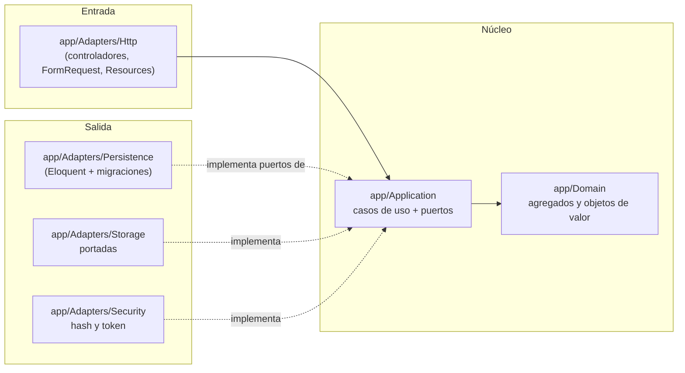
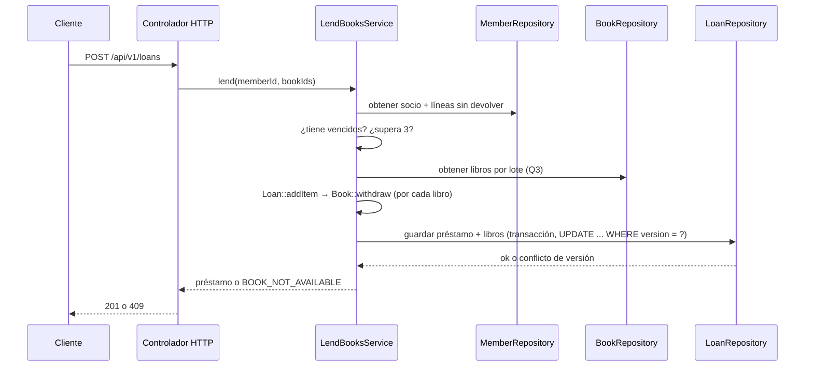

# Arquitectura — Manager Library (Laravel)

Arquitectura **hexagonal** (puertos y adaptadores) sobre Laravel. Las reglas de dependencia son los artículos I a III de [`constitution.md`](constitution.md). El modelo de datos, el contrato de la API y las reglas de negocio son los de [`spec-python/`](../spec-python/).

## 1. Capas y dependencias



Las flechas de dependencia apuntan **hacia adentro**. `app/Bootstrap` es el único que ve las dos mitades.

## 2. Reglas de dependencia (Deptrac)

| Capa | Puede depender de | No puede depender de |
|---|---|---|
| `Domain` | nada | `Application`, `Adapters`, `Bootstrap`, `Illuminate\*` |
| `Application` | `Domain` | `Adapters`, `Bootstrap`, `Illuminate\*` |
| `Adapters` | `Application`, `Domain`, `Illuminate\*` | `Bootstrap` |
| `Bootstrap` | `Application`, `Adapters`, `Domain`, `Illuminate\*` | — |

La regla de `Application` sin `Illuminate\*` es la que hace real el Artículo II: los casos de uso no conocen Eloquent, `Storage`, `Hash` ni ningún facade.

Las reglas se escriben en `deptrac.yaml` en la raíz del repo `api` y se verifican en T-19. Hasta entonces son una especificación, no una prueba.

## 3. Estructura de carpetas

```text
app/
├── Domain/                    # Book, Loan, LoanItem, Member, User; Isbn, Quantity, DocumentNumber, DateRange
├── Application/
│   ├── Ports/                 # BookRepository, LoanRepository, MemberRepository, UserRepository,
│   │                          # ReportReader, Clock, PasswordHasher, TokenIssuer, CoverStorage
│   └── UseCases/              # LendBooksService, ReturnItemService, CreateBookService, SearchBooksService,
│                              # OverdueService, MostBorrowedReportService, LoginService, CreateLibrarianService
├── Adapters/
│   ├── Http/                  # controladores, FormRequest, Resources, manejador de errores
│   ├── Persistence/           # repositorios Eloquent, consulta del reporte
│   ├── Storage/               # portadas en disco o S3
│   └── Security/              # Argon2id, JWT
└── Bootstrap/
    └── Composition/
        └── PortBindings.php   # único punto de composición (Artículo III)
```

## 4. Agregados

| Raíz | Contiene | Invariantes que defiende |
|---|---|---|
| `Book` | `Isbn`, copias totales y disponibles, `version`, baja lógica | disponibles entre 0 y total; total ≥ 1; título no vacío |
| `Loan` | colección de `LoanItem` | 1 a 3 líneas; sin libro repetido; vencimiento a 14 días; inmutable salvo devolución |
| `Member` | `DocumentNumber` | documento obligatorio y único |
| `User` | rol, hash | nombre normalizado; rol en (`admin`, `librarian`) |

`Loan::addItem()` llama a `Book::withdraw()` antes de añadir la línea: descontar el ejemplar y crear la línea son **una sola operación**, dentro de una transacción de base de datos.
`Loan::returnItem()` llama a `Book::restock()` una sola vez por línea.

## 5. Flujo: registrar un préstamo



Si el `UPDATE` con `version` no afecta filas, el adaptador lanza el error de dominio correspondiente y la transacción se revierte. Ver D-04 en [`plan.md`](plan.md).

## 6. Errores

El dominio y la aplicación lanzan excepciones propias (`BookNotAvailable`, `MemberHasOverdue`, `MemberLimitExceeded`, …). **Solo** el adaptador HTTP las traduce al cuerpo único y al código de estado de [`spec-python/api-contract.md`](../spec-python/api-contract.md). Una excepción de Laravel nunca llega al cliente: el manejador de excepciones de `Adapters/Http` la convierte en el cuerpo de error único.

## 7. Qué no hay

Sin eventos, sin colas, sin caché, sin microservicios, sin multi-tenencia. Se añaden si un requisito lo pide, no antes.
