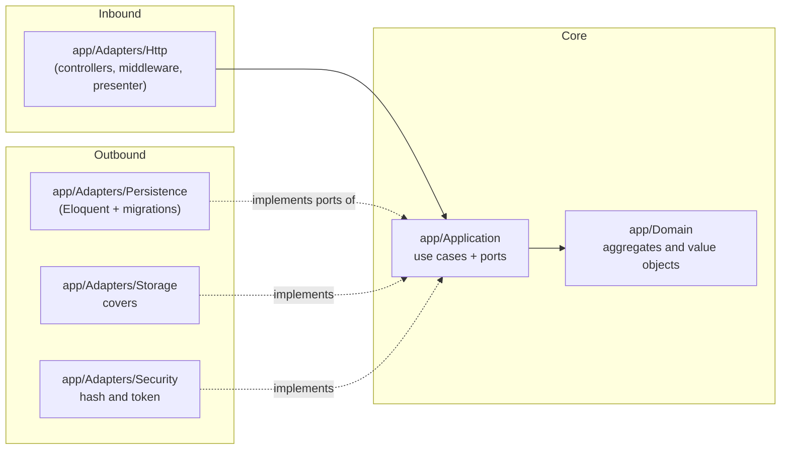
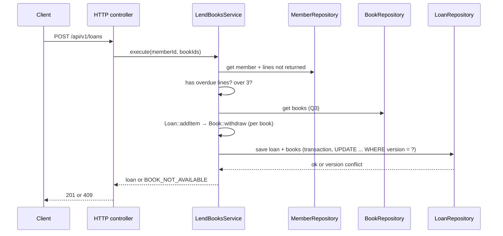

# Architecture — Manager Library (Laravel)

**Hexagonal** architecture (ports and adapters) on Laravel. The dependency rules are Articles I to III of [`constitution.md`](constitution.md). The data model, the API contract and the business rules are those of [`spec-python/`](../spec-python/).

## 1. Layers and dependencies



Dependency arrows point **inward**. `app/Bootstrap` is the only one that sees both halves.

## 2. Dependency rules (Deptrac)

| Layer | May depend on | May not depend on |
|---|---|---|
| `Domain` | nothing | `Application`, `Adapters`, `Bootstrap`, `Illuminate\*` |
| `Application` | `Domain` | `Adapters`, `Bootstrap`, `Illuminate\*` |
| `Adapters` | `Application`, `Domain`, `Illuminate\*` | `Bootstrap` |
| `Bootstrap` | `Application`, `Adapters`, `Domain`, `Illuminate\*` | — |

The rule that `Application` has no `Illuminate\*` is what makes Article II real: use cases know nothing about Eloquent, `Storage`, `Hash` or any facade.

The rules are written in `deptrac.yaml` at the root of the `api` repo and are verified in T-19.

## 3. Folder structure

```text
app/
├── Domain/                    # Book, Loan, LoanItem, Member, User; Isbn, Quantity, DocumentNumber, DateRange
├── Application/
│   ├── Ports/                 # BookRepository, LoanRepository, MemberRepository, UserRepository,
│   │                          # ReportReader, Clock, PasswordHasher, TokenIssuer, CoverStorage
│   ├── UseCases/              # LendBooksService, ReturnItemService, CreateBookService, SearchBooksService,
│   │                          # OverdueService, MostBorrowedReportService, LoginService, CreateLibrarianService
│   └── Errors/                # application errors, one per error code of the contract
├── Adapters/
│   ├── Http/                  # controllers, middleware, presenter, error mapping
│   ├── Persistence/           # Eloquent repositories, report query
│   ├── Storage/               # covers on disk or S3
│   ├── Security/              # Argon2id, JWT
│   └── System/                # clock, id generator
└── Bootstrap/
    ├── Composition/
    │   └── PortBindings.php   # single composition point (Article III)
    └── Console/               # library:bootstrap-admin
```

## 4. Aggregates

| Root | Contains | Invariants it defends |
|---|---|---|
| `Book` | `Isbn`, total and available copies, `version`, logical deletion | available between 0 and total; total ≥ 1; title not empty |
| `Loan` | collection of `LoanItem` | 1 to 3 lines; no repeated book; due date at 14 days; immutable except for returns |
| `Member` | `DocumentNumber` | document required and unique |
| `User` | role, hash | normalized name; role in (`admin`, `librarian`) |

`Loan::addItem()` calls `Book::withdraw()` before adding the line: taking the copy and creating the line are **a single operation**, inside one database transaction.
`Loan::returnItem()` calls `Book::restock()` exactly once per line.

## 5. Flow: registering a loan



If the `UPDATE` with `version` affects no row, the adapter throws the domain error and the transaction is rolled back. See D-04 in [`plan.md`](plan.md).

## 6. Errors

The domain and the application throw their own exceptions (`BookNotAvailable`, `MemberHasOverdue`, `MemberLimitExceeded`, …). **Only** the HTTP adapter translates them into the single body and status code of [`spec-python/api-contract.md`](../spec-python/api-contract.md). A Laravel exception never reaches the client: `Adapters/Http/ErrorResponse` turns it into the single error body.

## 7. What is not there

No events, no queues, no cache, no microservices, no multi-tenancy. They are added if a requirement asks for them, not before.
