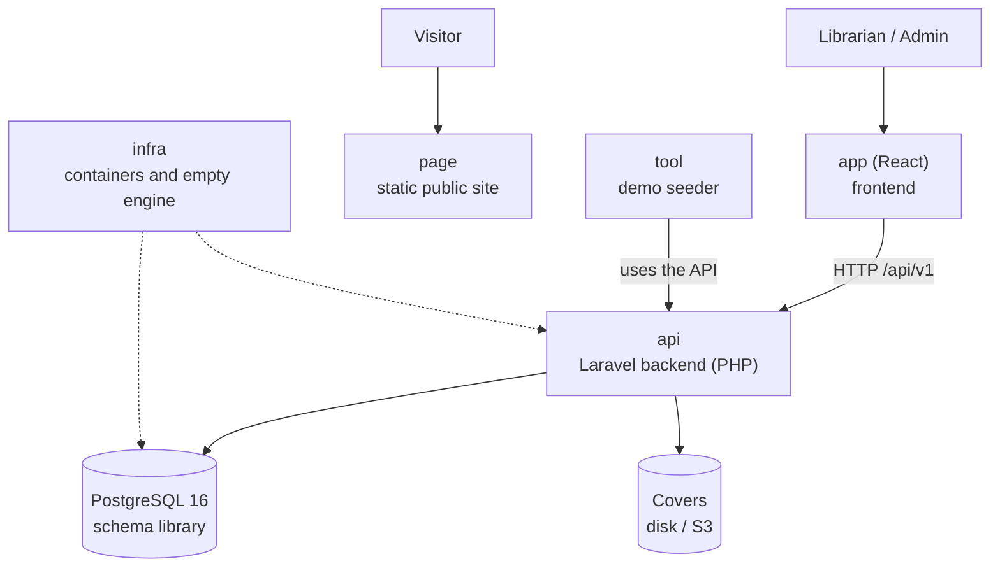

# Architecture on one page — Manager Library (Laravel)

To read in five minutes before opening the rest. The detail is in [`architecture.md`](architecture.md) and the decisions in [`plan.md`](plan.md).

## The system in one picture

## The six repositories and their role

| Repo | Role | Tested with |
|---|---|---|
| `docs` | The specification | That reading it is enough to build |
| `api` | Business rules and HTTP contract in Laravel | PHPUnit (domain, application, contract and concurrency) and Deptrac (layers) |
| `app` | Operation screens in React | Playwright: login → lend → return → report |
| `page` | Public presentation, without calling the API | Playwright at 375 px and 1280 px |
| `infra` | `docker compose up` and the empty database | That it starts with one command and has no tables |
| `tool` | Demo data through the API | That `/loans/overdue` and the report have real data |

## The five ideas that hold the design

1. **A loan is an immutable fact**; only the `returned_at` of a line changes.
2. **Copies are taken and returned within the same operation** that creates or closes the line.
3. **Status is calculated**: `open`, `overdue` or `closed` are not in the database.
4. **What is frozen does not follow the catalog**: the October report does not change because a book is renamed in November.
5. **The database is the last barrier**: if the `CHECK` on copies fires, something wrote outside the system.

And one Laravel rule: **dependencies point toward the domain**. Deptrac verifies it: `Domain` knows nobody, `Application` only knows the domain, and only `Adapters` and `Bootstrap` touch the framework.
